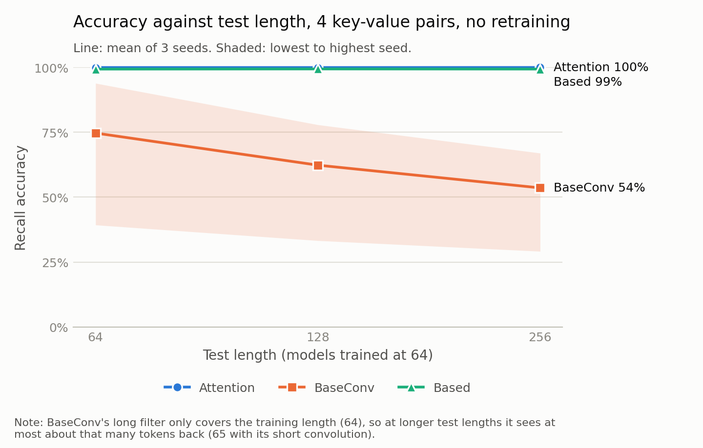

# Recall at Unseen Lengths and Distances on MQAR

A small reproduction and controlled extension of
[Zoology: Measuring and Improving Recall in Efficient Language Models](https://arxiv.org/abs/2312.04927)
(Arora, Eyuboglu, Timalsina, Johnson, Poli, Zou, Rudra, Ré).

**Question:** if a model learns multi-query associative recall (MQAR) on sequences of length 64,
does recall still work at longer lengths, and at key-to-query distances it never saw in training?

**Answer so far (3 seeds for the plotted models):** Attention and Based keep their accuracy.
BaseConv loses accuracy, and the loss comes entirely from keys further back than its filter can
reach. BaseConv's training also varies widely between seeds, from 39% to 94% at length 64.

This repo holds only my experiment code, a small patch and my results. The models and task
come from the [Zoology repository](https://github.com/HazyResearch/zoology), which you need to
run anything here.

## Results



All models were trained at length 64 and tested without retraining, with 4 key-value pairs at
every length. The plot and the tables marked "seed 123" show each model's best run from the sweep,
chosen by accuracy at length 64 only.

| Model | Width | Length 64 | Length 128 | Length 256 |
|---|---|---|---|---|
| Attention | 64 | 99.99% | 99.98% | 99.98% |
| Based | 64 | 99.52% | 99.52% | 99.48% |
| BaseConv | 128 | 93.89% | 77.90% | 66.97% |

### Across seeds

I repeated those three runs with two new seeds, changing both the starting weights and the
training data. Seed 123 was chosen as the best run and the new seeds were not, so seed 123 is
likely to look slightly better. Each cell shows seeds 123 / 124 / 125.

| Model | Length 64 | Length 128 | Length 256 |
|---|---|---|---|
| Attention | 99.99 / 99.94 / 99.97% | 99.98 / 99.96 / 99.95% | 99.98 / 99.99 / 99.98% |
| Based | 99.52 / 99.50 / 99.08% | 99.52 / 99.58 / 99.17% | 99.48 / 99.51 / 99.16% |
| BaseConv | 93.89 / 90.95 / 39.28% | 77.90 / 75.86 / 33.25% | 66.97 / 64.64 / 29.12% |

Attention and Based barely change between seeds. BaseConv seed 125 ran normally but levelled off
near 40% validation accuracy, so a single BaseConv number says little on its own.

BaseConv's drop has the same shape in all three seeds. At length 256, 71.5% of the test queries
have a distance of 64 or less, and each seed keeps 71-74% of its length 64 accuracy. At length 128
that share is 83.3%, and each seed keeps 83-85%.

### Accuracy by distance

Distance is the query position minus the position of its matching key. This table is seed 123 at
test length 256. Distances above 64 never occur in training. Across all three seeds and both longer
test lengths, BaseConv is 0.00% in every bin above 64, Attention is at least 99.86%, and Based is
at least 98.04%.

| Distance | Attention | Based | BaseConv |
|---|---|---|---|
| 1-16 | 99.96% | 99.40% | 92.84% |
| 17-32 | 100.00% | 99.66% | 94.11% |
| 33-48 | 100.00% | 99.72% | 94.77% |
| 49-64 | 100.00% | 99.74% | 96.03% |
| 65-80 | 100.00% | 99.64% | 0.00% |
| 81-96 | 100.00% | 99.54% | 0.00% |
| 97-128 | 100.00% | 99.44% | 0.00% |
| 129-192 | 100.00% | 99.50% | 0.00% |
| 193-256 | 100.00% | 98.75% | 0.00% |

BaseConv's long filter only covers the training length (64), so at longer test lengths it sees
at most about that many tokens back (65 with its short convolution). This cutoff is expected from
the filter size. The more interesting part is that Attention and Based, with no position table,
work at distances they were never trained on.

### More key-value pairs

With the paper's pairing of 8 pairs at length 128 and 16 pairs at length 256, length and task
difficulty change together, so these numbers are not a pure length test. Each cell shows the mean
of 3 seeds, then the lowest and highest seed.

| Model | 4 pairs, length 64 | 8 pairs, length 128 | 16 pairs, length 256 |
|---|---|---|---|
| Attention | 99.97% (99.94-99.99) | 99.93% (99.91-99.96) | 99.88% (99.83-99.92) |
| Based | 99.37% (99.08-99.52) | 97.47% (96.42-98.04) | 88.71% (85.30-90.43) |
| BaseConv | 74.71% (39.28-93.89) | 33.25% (15.87-43.62) | 9.22% (4.80-11.98) |

### Reproduction

Best validation accuracy over the two learning rates, at the end of training (seed 123):

| Model | L64, d64 | L64, d128 | L128, d64 | L128, d128 |
|---|---|---|---|---|
| Attention | 99.98% | 99.98% | 99.99% | 100.00% |
| Based | 99.55% | 99.52% | 99.43% | 99.62% |
| BaseConv | 55.55% | 93.45% | 10.39% | 51.38% |

Attention and Based match the paper's pattern. **BaseConv does not fully reproduce:** at length
128 and width 64 it reached about 10%, against roughly 37% read from the paper's Figure 2.

I tested two possible causes at learning rate 1e-2
([experiments/zoology_repro/gap.py](experiments/zoology_repro/gap.py),
[results/gap_results.csv](results/gap_results.csv)):

| Setting | Seeds | Validation accuracy |
|---|---|---|
| Power-law setting 0.01 (Figure 2 config) | 123, 124, 125 | 10.38%, 10.23%, 10.30% |
| Power-law setting 0.1 (paper's text) | 123, 124 | 10.28%, 10.15% |

Neither seed nor power-law setting closes the gap. All five runs fail in the same way: about 80% of
their answers are one of the 8 values in the sequence, but they pick among those values at random.
Dividing by 8 gives 9.9-10.1%, which matches their measured 10.1-10.6% on a shared test set. Accuracy
is also flat across distances, so this looks like a capacity limit at width 64 rather than a
distance limit. The width 128 run reaches 51%.

Three differences remain untested: Figure 2's config uses batch size 512 at this length (too large
for 8 GB), I used only 2 of its 4 learning rates, and the 37% value is read from the figure by eye.

## Limits

- Only the three plotted length 64 runs and BaseConv at length 128, width 64 have 3 seeds. All
  other runs have one seed, and 3 seeds
  is still too few for a reliable estimate of BaseConv's spread.
- The setup is smaller than the paper's: 2 of 4 learning rates, batch size 256 at length 128 to
  fit an 8 GB GPU, and at most 64 epochs. BaseConv used all 64 epochs, so it may not have converged.
- The data uses the power-law setting from the Figure 2 config (0.01). The paper's text reports
  0.1, which I tested only for the BaseConv gap above.
- I make no claim that this result is new. Later Zoology configs also test some models at longer
  lengths. [Li et al. (2024)](https://arxiv.org/abs/2407.05591) prove that attention with short
  convolutions can solve associative recall at any length once it solves it at one length, which
  fits the Attention result here. The Zoology paper already suggests that gated convolutions handle
  only some key-to-query distances; the distance table above measures that directly for BaseConv.
  I have not done a full literature review.

## Model setup

No model has a position table (`max_position_embeddings=0`), so every model accepts any length.
Attention and Based use the definitions in `zoology/experiments/models_repo.py`. BaseConv is the
Figure 2 model (`kernel_size=[3, -1, 3, -1]`). Full settings are in
[experiments/zoology_repro/configs.py](experiments/zoology_repro/configs.py).

## Run it

Tested on Windows 11 with Python 3.12, PyTorch 2.11 and an 8 GB GPU, at Zoology commit
`1ad20d193b6113cae1e8f3c655c300d7b4b3f4bb`. Training all 24 runs took several hours.

From PowerShell, in this repo's parent folder:

```powershell
git clone -c core.autocrlf=false https://github.com/HazyResearch/zoology.git
cd zoology
git checkout 1ad20d193b6113cae1e8f3c655c300d7b4b3f4bb
git apply ..\mqar-length-distance-recall\patches\windows_and_local_results.patch
Copy-Item -Recurse ..\mqar-length-distance-recall\experiments\zoology_repro zoology\experiments\

pip install torch numpy einops tqdm click pydantic pandas matplotlib transformers

python -m zoology.launch zoology/experiments/zoology_repro/configs.py
python -m zoology.experiments.zoology_repro.evaluate_length
python -m zoology.experiments.zoology_repro.evaluate_distance
python -m zoology.experiments.zoology_repro.plot

python -m zoology.launch zoology/experiments/zoology_repro/seeds.py
python -m zoology.experiments.zoology_repro.seeds

python -m zoology.launch zoology/experiments/zoology_repro/gap.py
python -m zoology.experiments.zoology_repro.gap
```

Results are written to `results/zoology_repro/` in the Zoology folder. Finished runs are skipped,
so training is safe to restart.

The patch makes two changes:

- It fixes a Windows crash, where `np.random.randint` overflowed the default 32-bit integer.
- It saves results to local files, so Weights & Biases is optional.

## Files

- `experiments/zoology_repro/`: run settings, the two evaluations and the plot
- `patches/windows_and_local_results.patch`: the changes to Zoology's own files
- `results/reproduction.csv`: one row per training run
- `results/length_generalization.csv`: accuracy per run, test length and number of pairs
- `results/distance_accuracy.csv`: accuracy per run, test length and distance bin
- `results/plotted_runs.csv`: the runs chosen for the plot
- `results/seed_length.csv`, `results/seed_distance.csv`: the same tests for every seed
- `results/seed_length_summary.csv`, `results/seed_distance_summary.csv`: mean, spread and range
- `results/gap_results.csv`: the BaseConv runs at length 128, width 64, with the answer check

## Credits

The task, models and training code are from Zoology, which is under the Apache License 2.0. The
patch modifies those files and stays under that license. If you use this work, please cite Zoology:

```bibtex
@article{arora2023zoology,
  title={Zoology: Measuring and Improving Recall in Efficient Language Models},
  author={Arora, Simran and Eyuboglu, Sabri and Timalsina, Aman and Johnson, Isys and Poli, Michael and Zou, James and Rudra, Atri and R{\'e}, Christopher},
  journal={arXiv preprint arXiv:2312.04927},
  year={2023}
}
```

I designed and directed this study, and used an AI coding assistant (Claude Code) to write the
code and run the experiments. This is an independent project, not affiliated with the Zoology authors.
